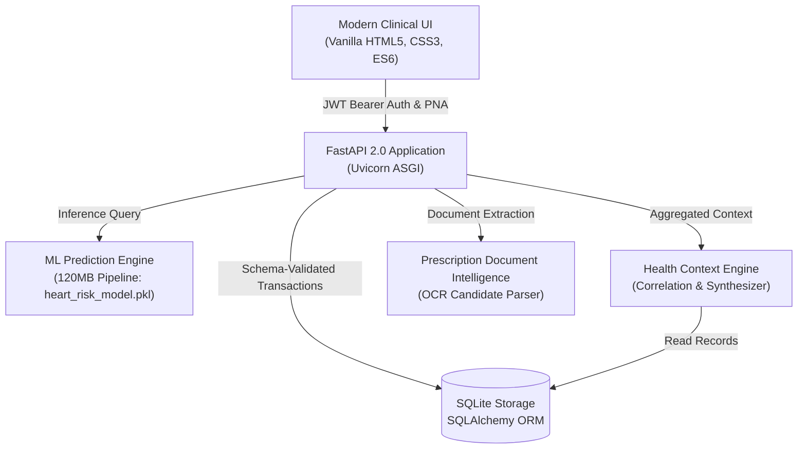

# HealthBridge AI — Personal Health Continuity Platform

> **Clinical Decision-Support & Personal Health Continuity Engine**  
> *Transforming fragmented medical records, symptoms, prescriptions, and ML-stratified risk scores into actionable doctor-visit intelligence.*

---

## 1. Executive Summary & Product Vision

**HealthBridge AI** is a startup-oriented personal health continuity platform designed to bridge the critical information gap between patients and healthcare professionals. Rather than treating patient records as isolated data silos, HealthBridge AI introduces the **Health Context Engine**: an intelligent correlation layer that synthesizes:

- **12-Feature Trained ML Risk Stratification** (evaluating cardiovascular indicators without fabricated probabilities).
- **Unified Health Timeline** (chronological feed of assessments, symptoms, prescriptions, and allergies).
- **Secure Prescription Vault & Document Intelligence** (multipart uploads, preview, candidate field extraction, and unverified-to-verified clinical review workflow).
- **Allergy & Safety Screening Profile** (tracking documented allergens, severity, and verification status).
- **Personalized Clinical Guidance** (structured action items, tailored precautions, specialist referrals, and emergency protocol screening).
- **Doctor-Visit Briefing & Consent-Based Sharing** (editable pre-visit consultation summaries exportable to printable PDF or shared via cryptographic, time-limited, PIN-protected tokens).

---

## 2. System Architecture



### Core Technologies
- **Frontend**: Accessible Vanilla HTML5, CSS3 Custom Properties (Dark Teal Clinical Design System), Modular ES6 (`common.js`, `api.js`, `timeline.js`, `briefing.js`, `prescription.js`).
- **Backend**: FastAPI 0.110+ on Python 3.12, Uvicorn ASGI server.
- **Security & Networking**: Chrome Private Network Access (PNA) compliance middleware, PBKDF2/Bcrypt password hashing, OAuth2 Password Bearer JWTs, Strict Multi-Tenant Record Isolation.
- **Machine Learning**: 120.5 MB production-trained Scikit-learn / XGBoost pipeline (`heart_risk_model.pkl`), evaluating 12 clinical indicators (age, sex, chest pain type, resting BP, serum cholesterol, fasting blood sugar, resting ECG, max heart rate, exercise angina, ST oldpeak, slope, major vessels).
- **Database**: SQLite3 (`health_risk.db`) with auto-migrating SQLAlchemy schemas.

---

## 3. Project File Structure

```
project2advance/
├── assets/                  # Brand vectors, favicons, illustrations
├── database/
│   ├── database.py          # SQLite engine, session factory, auto-migrations
│   └── models.py            # User, HealthAssessment, RecentProblem, Prescription,
│                            # PrescriptionMedicine, Allergy, DoctorBriefing, SharedBriefing
├── routes/
│   ├── auth.py              # Register, login, me, session audit
│   ├── prediction.py        # ML risk prediction & assessment history
│   ├── problems.py          # Symptom logging, categories, severity, status
│   ├── prescriptions.py     # Vault upload, extraction, file retrieval
│   ├── allergies.py         # Allergy profiles & verification status
│   ├── recommendations.py   # Multi-tier clinical guidance & emergency warnings
│   ├── timeline.py          # Unified chronological health feed
│   ├── briefings.py         # Doctor briefing CRUD, drafts, cryptographic sharing
│   └── users.py             # User profile management
├── schemas/
│   └── schemas.py           # Pydantic v2 data transfer objects & validation
├── services/
│   ├── auth_handler.py      # JWT encoding/decoding, passlib bcrypt security
│   ├── prediction_service.py# Zero-mock inference using heart_risk_model.pkl
│   ├── recommendation_service.py # Decoupled guidance and safety warnings
│   ├── context_engine.py    # Health Context Engine & Briefing Synthesizer
│   └── document_extractor.py# Prescription document parsing & candidate extraction
├── uploads/                 # Private server-side storage for uploaded prescriptions
├── index.html               # Main Dashboard & ML Assessment Portal
├── timeline.html            # Unified Health Timeline Interface
├── briefing.html            # Doctor-Visit Briefing Builder & PDF Export
├── prescription.html        # Prescription Vault & Document Intelligence
├── allergies.html           # Allergy Management Profile
├── history.html             # Historical Assessments & Trends
├── result.html              # Estimated ML Risk Stratification View
├── recommendation.html      # Comprehensive Clinical Guidance
├── share.html               # Clinician-Facing Audited Briefing Viewer
├── style.css                # Dark Teal Medical Aesthetic & Printable CSS
├── api.js                   # Unified Frontend API Client
├── common.js                # Global Navigation, Auth Modal, State Sync
├── heart_risk_model.pkl     # Trained ML Pipeline (120.5 MB)
├── test_healthbridge_e2e.py # Automated 18-step verification test suite
└── main.py                  # FastAPI Application Entry Point
```

---

## 4. Setup and Quick Start

### Prerequisites
- Python 3.10+ (Python 3.12 recommended)
- Modern Web Browser (Chrome, Edge, Firefox, Safari)

### 1. Installation
Clone or navigate to the project directory:
```bash
cd "c:/Users/Sayan Mridha/Desktop/project2advance"
```

Install backend dependencies:
```bash
pip install fastapi uvicorn sqlalchemy pydantic python-jose passlib bcrypt python-multipart scikit-learn xgboost joblib pillow
```

### 2. Launching the Backend Server
Start the Uvicorn ASGI server on port `8000`:
```bash
python -u -m uvicorn main:app --host 0.0.0.0 --port 8000 --reload
```
*The database tables and missing schema columns will automatically migrate on startup.*

### 3. Accessing the Platform
Open your browser and navigate to:
```
http://127.0.0.1:8000/
```
You can also launch a static server (e.g. Live Server on port 5500) or open `index.html` directly—the built-in Private Network Access middleware seamlessly supports cross-origin local requests.

---

## 5. API Specification Overview

| Route | Method | Access | Purpose |
| :--- | :--- | :--- | :--- |
| `/auth/register` | `POST` | Public | Register new patient account |
| `/auth/login` | `POST` | Public | Obtain signed JWT Bearer token |
| `/auth/me` | `GET` | Authenticated | Retrieve authenticated user profile |
| `/predict` | `POST` | Public/Auth | Execute real ML inference with auto-save for authenticated users |
| `/predict/history` | `GET` | Authenticated | Retrieve chronological assessment history |
| `/problems` | `GET`, `POST`, `PUT`, `DELETE` | Authenticated | Symptom logging with severity, duration, and status tracking |
| `/allergies` | `GET`, `POST`, `PUT`, `DELETE` | Authenticated | Allergy tracking with verification status |
| `/api/prescriptions` | `GET`, `POST`, `DELETE` | Authenticated | Multipart upload and retrieval with linked medicine structures |
| `/api/prescriptions/extract` | `POST` | Authenticated | Document intelligence candidate parser (unverified extraction) |
| `/api/prescriptions/{id}/file`| `GET` | Authenticated | Stream original prescription document securely |
| `/api/timeline` | `GET` | Authenticated | Chronological timeline across all patient records |
| `/api/briefings/draft` | `POST` | Authenticated | Synthesize consultation briefing draft from stored context |
| `/api/briefings` | `GET`, `POST`, `PUT`, `DELETE` | Authenticated | CRUD for doctor visit briefings |
| `/api/briefings/{id}/share` | `POST` | Authenticated | Generate time-limited sharing token with optional PIN |
| `/api/briefings/share/{token}`| `DELETE` | Authenticated | Instantly revoke active share token |
| `/api/briefings/shared/{token}`| `GET` | Public (PIN-gated) | Audited clinician viewer |
| `/api/recommendations` | `GET` | Authenticated | Context-aware clinical guidance and interaction warnings |

---

## 6. End-to-End Verification Suite

The repository includes a comprehensive 18-journey automated verification script with zero third-party dependencies (`test_healthbridge_e2e.py`).

To run the verification suite:
```bash
python -u test_healthbridge_e2e.py
```

### Verified Clinical Flows:
1. `Step 01`: User Registration & JWT Authentication
2. `Step 02`: 12-Feature ML Inference (`heart_risk_model.pkl`)
3. `Step 03`: Assessment History Auto-Persistence
4. `Step 04`: Symptom Logging with Status & Notes
5. `Step 05`: Prescription Document Intelligence Extraction
6. `Step 06`: Structured Prescription Multipart Upload
7. `Step 07`: Prescription Vault Retrieval & Medicine Foreign Keys
8. `Step 08`: Allergy Profile Creation & Verification
9. `Step 09`: Unified Health Timeline Aggregation
10. `Step 10`: Context Engine Doctor Briefing Draft Synthesis
11. `Step 11`: Doctor Briefing Record Creation & Retrieval
12. `Step 12`: Cryptographic Share Token Creation
13. `Step 13`: Clinician Viewer with PIN Protection & Audit
14. `Step 14`: Instant Share Token Revocation (HTTP 410 Gone)
15. `Step 15`: Cross-Session Data Persistence
16. `Step 16`: Multi-Tenant Authorization & Isolation (404 on cross-user access)
17. `Step 17`: FastAPI Input Validation & Boundary Protection (422 rejection)
18. `Step 18`: Decoupled Clinical Guidance & Emergency Warnings

---

## 7. Regulatory Boundaries & Clinical Disclaimer

> **IMPORTANT CLINICAL NOTICE**  
> HealthBridge AI is an **educational and organizational decision-support platform**, NOT an autonomous diagnostic device or certified medical software.  
> - Predictions generated by the system represent statistical risk stratifications based on input features, not confirmed medical diagnoses.
> - Extracted prescription fields are marked as **Unverified** until confirmed by the patient or clinician.
> - The platform does not prescribe, dose, restart, or discontinue medications.
> - In case of acute or life-threatening symptoms (e.g. crushing chest pain, acute shortness of breath), patients must immediately contact emergency medical services.
# project2advance

# project2.0advance

